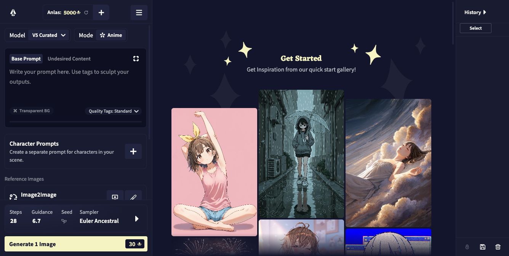
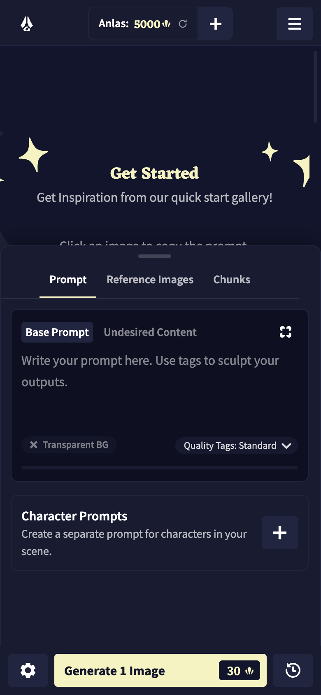

# NAI 生成器

**仿照 NovelAI 官方生图页的本地客户端，支持 Windows、macOS 和 Android。**

使用自己的 NovelAI Persistent API Token 登录后，可以直接在客户端里写提示词并生成图片，也能查看历史，继续使用图生图、局部重绘和编辑工具。

> 本仓库只发布安装包、界面预览和更新说明，不包含应用源码。



## 下载

当前安装包版本为 **1.3.1**。请按设备选择文件，不要同时安装两个 macOS 架构版本。

| 系统 | 适用设备 | 安装包 |
| --- | --- | --- |
| Windows | Windows 10 / 11，64 位 Intel 或 AMD | [NAI-Generator-win-x64-setup.exe](https://github.com/yueyu8277-blip/NAI-generator/releases/latest/download/NAI-Generator-win-x64-setup.exe) |
| macOS | Intel 芯片 | [NAI-Generator-mac-x64.dmg](https://github.com/yueyu8277-blip/NAI-generator/releases/latest/download/NAI-Generator-mac-x64.dmg) |
| macOS | Apple M 系列芯片 | [NAI-Generator-mac-arm64.dmg](https://github.com/yueyu8277-blip/NAI-generator/releases/latest/download/NAI-Generator-mac-arm64.dmg) |
| Android | Android 手机或平板 | [NAI-Generator-android.apk](https://github.com/yueyu8277-blip/NAI-generator/releases/latest/download/NAI-Generator-android.apk) |

也可以在 [Releases](https://github.com/yueyu8277-blip/NAI-generator/releases/latest) 页面查看全部文件。

### 怎样选择 Mac 安装包

打开屏幕左上角的 **Apple 菜单 → 关于本机**：

- 显示“芯片：Apple M…”时，下载 `mac-arm64.dmg`。
- 显示“处理器：Intel…”时，下载 `mac-x64.dmg`。

## 主要功能

- 接近 NovelAI 官方生图页的桌面布局。模型和模式沿用官方结构，提示词和角色提示词都能直接编辑。
- 尺寸和采样器可以随时调整，右侧保留历史栏。
- 支持 NovelAI API 生图，并在生成过程中显示流式预览。
- 支持图生图和局部重绘。可以继续使用 Director Tools，放大和 Vibe Transfer 也已接入。
- 支持角色提示词、V4 / V4.5 网格定位和 V5 自由选点。
- 内置 Tag 建议和 token 计数，输入提示词时可以继续补充常用 Tag。
- 历史图片可以进行比较，也能复制提示词并保留生成参数。
- 可以查看或清理 NovelAI 图片的 PNG 元数据，也能读取 A1111 和 ComfyUI 的信息。
- Android 版与桌面版共享同一套生图界面，手机上可直接连接 `image.novelai.net`。

## 第一次使用

1. 打开 NovelAI 的 **Account Settings**，复制 Persistent API Token。
2. 启动 NAI 生成器，在 API 设置中填入 Token。
3. 选择模型、尺寸和采样参数，输入提示词后生成图片。
4. 生成结果会进入历史栏。可以在那里比较和编辑图片，也可以继续做局部重绘或放大。

API Key 只用于连接 NovelAI。桌面版会保存在本机；Android 版在设备上加密保存，不经过额外中转服务器。

## 安装说明

### Windows

1. 运行 `NAI-Generator-win-x64-setup.exe`。
2. 选择安装位置，按向导完成安装。
3. 如果 Microsoft Defender SmartScreen 显示“Windows 已保护你的电脑”，请确认文件来自本仓库，再选择 **更多信息 → 仍要运行**。

### macOS

1. 打开下载的 DMG。
2. 将“NAI生成器”拖入“应用程序”。
3. 首次打开时，如果系统提示无法验证开发者，请前往 **系统设置 → 隐私与安全性**，确认来源后选择 **仍要打开**。

安装包尚未进行 Apple 开发者签名和公证，macOS 可能显示安全提示。

### Android



1. 下载并打开 APK。
2. 如果系统阻止安装，请在当前浏览器或文件管理器中允许“安装未知应用”。
3. 安装完成后，在应用内填写 NovelAI API Token。

## 网络与隐私

- 生成请求由客户端直接发送到 NovelAI。仓库维护者不会接收你的 API Key 或提示词。
- 桌面版可以读取系统代理设置，也可以检测本机常见代理端口后连接 NovelAI。
- Android 版直接使用手机系统网络；如果需要代理，请在手机网络设置中启用。
- 使用记录和图片历史保存在本机。删除应用数据前，请先备份需要保留的内容。
- 本项目与 NovelAI 官方不存在隶属或授权关系。NovelAI 及相关商标归其权利人所有。

## 文件校验

Release 中附有 [`SHA256SUMS.txt`](SHA256SUMS.txt)。下载后可核对文件，确认传输过程没有损坏。

macOS：

```bash
shasum -a 256 NAI-Generator-mac-arm64.dmg
shasum -a 256 NAI-Generator-mac-x64.dmg
```

Windows PowerShell：

```powershell
Get-FileHash .\NAI-Generator-win-x64-setup.exe -Algorithm SHA256
```

Android APK：

```bash
shasum -a 256 NAI-Generator-android.apk
```

## 本次发布

- 仓库首页已替换为 NAI 生成器下载页。
- Windows 和两种 macOS 架构的桌面安装包，以及 Android 安装包，均已集中到 `v1.3.1`。
- DMG 已通过镜像校验，APK 已通过压缩包完整性检查。
- 四个安装包均已生成 SHA-256 校验值。

详细说明见 [NAI Generator v1.3.1](https://github.com/yueyu8277-blip/NAI-generator/releases/tag/v1.3.1)。

## 已知限制

- macOS 和 Windows 安装包目前没有开发者签名，首次安装可能出现系统安全提示。
- 图片生成需要有效的 NovelAI 账号、API Token 和网络连接。API 是否可用、点数如何扣除，由 NovelAI 决定。
- 本仓库仅发布成品安装包，不提供源码，也未附带开源许可证。

遇到问题时，请在 [Issues](https://github.com/yueyu8277-blip/NAI-generator/issues) 中写明系统版本和安装包名称。操作步骤和错误提示也请一并附上。请勿公开 API Key 或包含私人提示词的截图。
