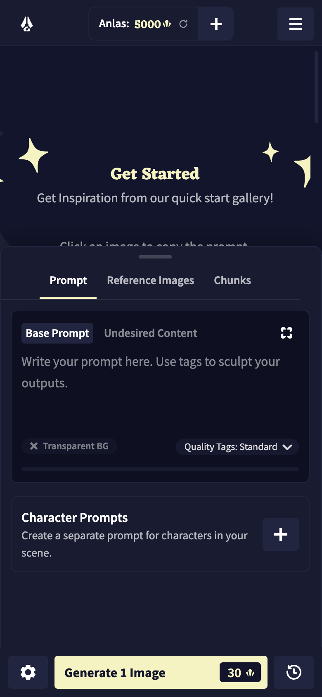

# NAI 生成器 1.2.1 发布说明

发布日期：2026-11-12

## 本次发布

NAI 生成器 1.2.1 提供一个统一下载入口，包含 Windows、macOS 和 Android 安装包。仓库首页也已从旧的作者助手介绍切换为生成器下载页。

本次地址：

https://github.com/yueyu8277-blip/NAI-generator/releases/tag/generator-v1.2.1

## 安装包

| 文件 | 平台 | 大小 |
| --- | --- | --- |
| `NAI-Generator-1.2.1-win-x64-setup.exe` | Windows 10 / 11 x64 | 87.2 MB |
| `NAI-Generator-1.2.1-mac-x64.dmg` | macOS Intel | 93.0 MB |
| `NAI-Generator-1.2.1-mac-arm64.dmg` | macOS Apple Silicon | 89.7 MB |
| `NAI-Generator-1.2.1-android.apk` | Android | 9.6 MB |

Apple M 系列芯片请选择 `mac-arm64.dmg`。Intel Mac 请选择 `mac-x64.dmg`。

## 功能概览

- 接近 NovelAI 官方生图页的桌面界面。
- 使用 Persistent API Token 连接 NovelAI 生图。
- 正向和负面提示词都可以编辑。角色提示词、Tag 建议和 token 计数也已接入。
- 支持图生图和局部重绘。可以继续使用 Director Tools，放大和 Vibe Transfer 也已接入。
- 支持 V4 / V4.5 网格定位及 V5 自由选点。
- 生成过程中提供流式预览。历史记录里可以比较图片，也可以查看 PNG 元数据。
- Android 版可直接连接 NovelAI，不需要额外的中转服务器。

## 安装提示

Windows 和 macOS 安装包目前没有开发者签名。首次启动时，系统可能要求确认来源。

macOS：

1. 打开 DMG。
2. 将“NAI生成器”拖入“应用程序”。
3. 如果提示无法验证开发者，请在 **系统设置 → 隐私与安全性** 中选择 **仍要打开**。

Windows：

1. 运行安装包。
2. 如果出现 SmartScreen 提示，请确认文件来自本仓库，再选择 **更多信息 → 仍要运行**。

Android：



1. 下载 APK 并在文件管理器中打开。
2. 允许当前应用安装未知来源应用。
3. 安装完成后，在应用内填写 NovelAI API Token。

## SHA-256

```text
4618c0105fbd533d74c76dec2bad6a7de2b69b8c46f47c2cbbd21f3ee47bc034  NAI-Generator-1.2.1-win-x64-setup.exe
322e75e1abfd6b4deb45b5ec41145b122a8e7db9ff24baac9144fca10144dad0  NAI-Generator-1.2.1-mac-x64.dmg
e1f6268ca4e65c84b00d38ffbf1c674193ae0a288fb979bc9c14d3a1ddfe83e5  NAI-Generator-1.2.1-mac-arm64.dmg
57323db967d238f1aa1d94af52a6030a1578e4bcf2a437f1de57c43e7e11d204  NAI-Generator-1.2.1-android.apk
```

完整校验文件见 Release 中的 `SHA256SUMS.txt`。

## 检查结果

- 两个 macOS DMG 已通过 `hdiutil verify`，镜像校验有效。
- Android APK 已通过 `unzip -t`，压缩数据无错误。
- Windows 安装包已确认为 64 位 NSIS 安装程序。
- 四个文件均已记录 SHA-256。

## 使用边界

生成图片需要用户自己的 NovelAI 账号和有效 API Token。API 可用性、点数消耗和账号限制由 NovelAI 决定。

桌面版和 Android 版都会在本机保存必要的 API 设置和图片历史。卸载或清除应用数据前，请先备份需要保留的内容。

本项目仅发布成品安装包，不提供源码，也未附带开源许可证。本项目与 NovelAI 官方不存在隶属或授权关系。
